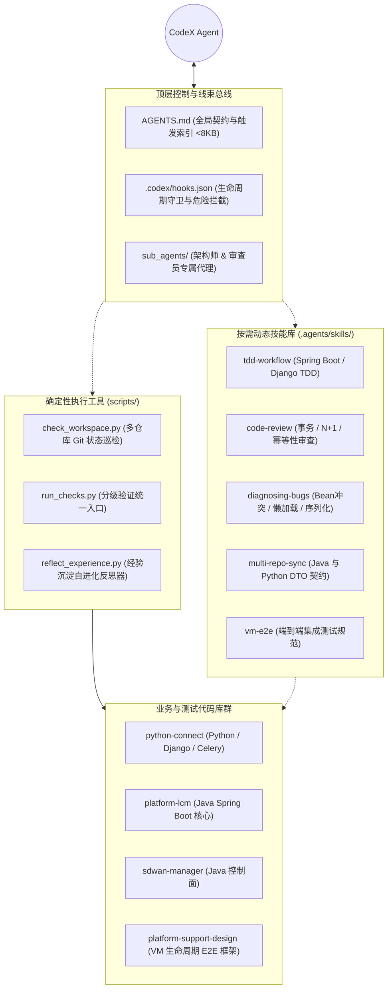
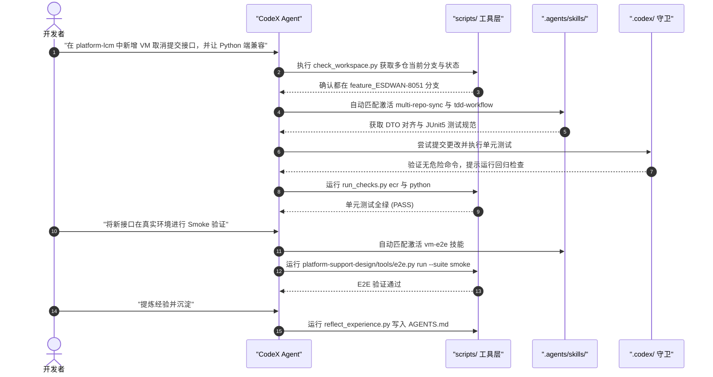

## 0. 前置认知：Harness² 智能体进化蓝图

在深入探讨企业级多代码库的工程落地之前，建议读者先翻阅下方这份完整的 **《Harness² 智能体进化蓝图》**。该文档系统性地梳理了智能体编程范式从早期的静态 Prompt 约束（Harness 1.0），跃迁至具备“动态技能按需加载、确定性工具总线、生命周期守卫、递归自进化反思”四维标准的 **Harness 2.0（CODEX_SURFACE）** 核心思想，帮助您建立清晰的理论底座：


💡 **在线阅览提示**：下方已内嵌完整版《Harness² 智能体进化蓝图》PDF 文档，支持在线翻页、放大、全屏浏览以及一键下载。




---

## 1. 背景与痛点：从单仓玩具到企业级多仓工程

在当前 AI 编程（如 CodeX、Claude Code、Antigravity 等）的普及过程中，许多开发者在单独一个小型项目（例如单体 Node.js 或单模块 Python 脚本）中能获得惊艳的体验。然而，一旦把 AI 引入企业级真实研发环境，尤其面对**多代码库（Multi-Repo）、异构技术栈（如 Java Spring Boot 与 Python 混合架构）以及长链路端到端集成测试**时，通常会迅速陷入以下几大典型困境：

1. **上下文爆炸与漂移**：多仓库代码总量动辄数百万行，直接将所有背景信息塞入 Prompt 会迅速挤爆上下文窗口（Context Window），导致模型注意力稀释、生成幻觉代码。
2. **跨仓库契约不一致**：前端/调度服务用 Python，后端核心业务用 Java，修改一个 API 很容易造成 REST DTO 字段不匹配或类型断裂。
3. **缺乏安全防护壁垒**：AI 可能会执行诸如 `git reset --hard`、`git push --force` 或误删生产配置等危险破坏性命令。
4. **验证流程割裂**：每个子仓库的构建测试命令不同（Maven/Gradle、pytest/unittest、E2E 脚本），AI 无法自动完成多层次的分级闭环验证。
5. **“从不长记性”的重复踩坑**：上一次任务调试解决的依赖冲突或环境陷阱，在下一次全新会话中会被 AI 彻底遗忘。

针对上述难题，Google 提出的 **Harness²（线束工程 2.0 / Agent Harness）** 标准体系给出了系统性的工程化答案：**不要把 AI 仅仅当成代码补全器，而是围绕 AI 建立一套由“总控线束 + 按需专家技能 + 确定性脚本 + 生命周期守卫 + 递归自进化反思”组成的坚固底盘。**

本文将以一个真实的企业级混合架构项目（代号 **LCM**，包含多个 Java Spring Boot 核心服务、Python 任务调度服务以及独立平台 E2E 测试环境）为例，详细拆解如何将 Harness² 体系无缝嫁接到 CodeX 中，并提供可直接复制落地的实践规范。

---

## 2. 总体架构：多代码库的 Harness² 拓扑设计

在多代码库环境下，我们不能把线束散落在各个孤立的子仓库中，而是在**多代码库的父级总控目录**建立全局线束，同时保持下属各子仓库的轻量与自治。

### 2.1 整体拓扑图



### 2.2 目录结构清单与交付契约

```text
D:\Company\Codes\LCM\                   # 多代码库总根目录（工作区）
├── AGENTS.md                          # [核心指令与总线束] 全局规范、多仓协同规则、技能自动触发索引 (<8KB)
├── .agents/
│   └── skills/                        # [按需动态技能库] 只有触发匹配时才加载对应内容
│       ├── tdd-workflow/
│       │   └── SKILL.md               # 技能1：Spring Boot + Django 测试先行与回归
│       ├── code-review/
│       │   └── SKILL.md               # 技能2：高标准代码审查（事务、空安全、N+1）
│       ├── diagnosing-bugs/
│       │   └── SKILL.md               # 技能3：跨服务调用、Bean冲突、Celery故障排查
│       ├── multi-repo-sync/
│       │   └── SKILL.md               # 技能4：跨模块依赖查找与 Python/Java REST DTO 兼容
│       └── vm-e2e/
│           └── SKILL.md               # 技能5：端到端集成测试、状态账本验证与执行入口
├── scripts/                           # [确定性辅助工具] 消除 AI 随意拼凑命令的不确定性
│   ├── check_workspace.py             # 脚本1：多代码库分支与未提交变动一键巡检
│   ├── run_checks.py                  # 脚本2：跨仓库编译/类型检查/单元测试/E2E统一分级执行器
│   └── reflect_experience.py          # 脚本3：Harness² 经验反思器（自动提炼经验写回 AGENTS.md）
├── sub_agents/                        # [独立角色代理]
│   ├── architect/
│   │   └── AGENT.md                   # 架构师角色：负责跨库接口设计与重构方案制定
│   └── reviewer/
│       └── AGENT.md                   # 审查员角色：负责质量验收与提交规范审查
├── .codex/
│   └── hooks.json                     # [生命周期钩子] 拦截危险命令 (rm -rf, git reset) + 语法格式化
├── python-connect/                    # 子仓库 A：Python 业务服务
├── platform-lcm/                      # 子仓库 B：Java Spring Boot 核心业务
├── sdwan-manager/                     # 子仓库 C：Java 集群控制服务
└── platform-support-design/           # 子仓库 D：底层 VM 生命周期端到端测试仓
```

---

## 3. 分步实施落地指南

### 第一步：编写极简全局总控线束（`AGENTS.md`）

#### 为什么必须保持极简（<8KB）？
在 Harness² 规范中，**`AGENTS.md` 是每次交互常驻系统上下文的根指令**。如果把数万字的架构说明、测试文档全塞进 `AGENTS.md`，会严重浪费 Token 预算并干扰模型的推理能力。正确的做法是：
- `AGENTS.md` 只保留**核心原则、多仓工作区拓扑、工具契约**以及**技能自动唤醒索引表**。
- 具体的工程细节全部拆分到各个 `SKILL.md` 中，利用语义触发按需动态加载。

#### 核心代码配置示例：
在已有 `AGENTS.md` 的基础上，增量补充如下线束声明区（保留已有业务说明）：

```markdown
# Multi-Repo Master Engineering Harness (Harness² Standard)

## 1. Workspace Topology & Repositories
- `python-connect`: Python/Django/Celery service.
- `platform-lcm`: Java Spring Boot core management service.
- `sdwan-manager`: Java cluster controller.
- `platform-support-design`: End-to-end VM lifecycle test suite and tools.

## 2. Universal Engineering Rules
- **No Direct Destructive Commands**: Never execute `git reset --hard`, `git push --force`, or unverified deletions.
- **Verification First**: Always run local verification via `scripts/run_checks.py` before completing any task.
- **Multi-Repo DTO Consistency**: When modifying API payloads, maintain backward compatibility across Java and Python.

## 3. Dynamic Skills Trigger Mapping
Read the corresponding SKILL.md ONLY when the task matches the trigger:
- When writing new features or fixing bugs, read `.agents/skills/tdd-workflow/SKILL.md`.
- When reviewing pull requests or code quality, read `.agents/skills/code-review/SKILL.md`.
- When diagnosing complex exceptions or stack traces, read `.agents/skills/diagnosing-bugs/SKILL.md`.
- When modifying cross-repo APIs or DTOs between Python and Java, read `.agents/skills/multi-repo-sync/SKILL.md`.
- When preparing or running VM lifecycle End-to-End integration tests, read `.agents/skills/vm-e2e/SKILL.md`.

## 4. Deterministic Scripts Contract
- Workspace check: `python scripts/check_workspace.py`
- Fast checks: `python scripts/run_checks.py [all|python|ecr|v2-mgr|e2e]`
- Reflection & Lesson Record: `python scripts/reflect_experience.py --category <Category> --lesson "<Lesson>"`
```

---

### 第二步：建立按需触发的专家技能库（`.agents/skills/`）

技能文件（`SKILL.md`）需要具备标准的结构与操作步骤。以下是多仓实践中最关键的两个技能定义：

#### 技能 A：跨仓库 DTO 协同（`.agents/skills/multi-repo-sync/SKILL.md`）
跨语言代码库最容易发生字段命名不一致（如蛇形命名 `snake_case` 与驼峰命名 `camelCase`）、枚举值缺失等。

```markdown
---
name: multi-repo-sync
description: Cross-repository API, REST DTO, and data contract alignment between Python and Java
---

# Multi-Repo Contract Synchronization Workflow

## 1. Inspection Checklist
1. Identify the Producer and Consumer:
   - If Python produces JSON: Check Jackson deserialization annotations (`@JsonProperty`) in Java.
   - If Java produces JSON: Check serializer/pydantic models in Python.
2. Field naming conventions:
   - Ensure case mappings (`camelCase` vs `snake_case`) are explicitly declared.
3. Enum sync:
   - When adding a state in Java enum, immediately sync the Python choice enum.

## 2. Verification Protocol
1. Modify the DTO definitions in both repositories simultaneously.
2. Run unit tests in both repositories using `python scripts/run_checks.py python` and `python scripts/run_checks.py ecr`.
```

#### 技能 B：全链路端到端集成测试（`.agents/skills/vm-e2e/SKILL.md`）
在我们的项目里，`platform-support-design` 是端到端测试的总控仓。该技能直接规范了调用真实系统时的核心原则：

```markdown
---
name: vm-e2e
description: End-to-End VM lifecycle integration testing via platform-support-design tools
---

# VM Lifecycle E2E Testing Protocol

## Core Rules
1. **Never use test backdoors**: All tests must invoke the actual public APIs.
2. **HTTP 200 != Success**: Always verify against the state ledger (database & NetBox records) to confirm real VM provisioning.
3. **Platform Token Lifecycle**: Long-term reuse of existing environment tokens; do not generate transient tokens.

## Execution Procedure
- Preflight environment check:
  `python platform-support-design/tools/e2e.py check --env <profile.json>`
- Run Smoke test suite:
  `python platform-support-design/tools/e2e.py run --env <profile.json> --suite smoke`
- Cleanup test resources safely:
  `python platform-support-design/tools/e2e.py clean --env <profile.json>`
```

---

### 第三步：编写确定性工作区工具（`scripts/`）

让 AI 在终端中自由猜测、手动敲 `cd xxx && git status` 是极其低效且容易出错的。Harness² 强调使用**确定性的脚本（Deterministic Tools）**封装高频复杂动作。

#### 1. 多代码库状态巡检脚本：`scripts/check_workspace.py`
在开始任何复杂任务前，CodeX 首先运行该脚本，一眼看清所有子模块当前位于什么分支、有多少未提交的修改，避免把代码写错分支或覆盖同事的改动。

```python
#!/usr/bin/env python3
"""
scripts/check_workspace.py
Inspect git branches, working tree states, and recent commits across all sub-repos.
"""
import subprocess
from pathlib import Path

WORKSPACE_ROOT = Path(__file__).resolve().parent.parent

def check_repo(repo_dir: Path):
    if not (repo_dir / ".git").exists():
        return None
    try:
        branch = subprocess.check_output(
            ["git", "branch", "--show-current"], cwd=repo_dir, text=True
        ).strip() or "DETACHED"
        status_out = subprocess.check_output(
            ["git", "status", "--porcelain"], cwd=repo_dir, text=True
        )
        modified = staged = untracked = 0
        for line in status_out.splitlines():
            if not line:
                continue
            x, y = line[0], line[1]
            if x in "MADRC":
                staged += 1
            if y in "MADRC":
                modified += 1
            if x == "?" and y == "?":
                untracked += 1
        commit = subprocess.check_output(
            ["git", "log", "-1", "--format=%h %s"], cwd=repo_dir, text=True
        ).strip()[:30]
        return {
            "name": repo_dir.name,
            "branch": branch,
            "msu": f"{modified}/{staged}/{untracked}",
            "commit": commit,
        }
    except Exception as e:
        return {"name": repo_dir.name, "branch": "ERR", "msu": "-", "commit": str(e)}

def main():
    print("=" * 80)
    print(f"{'Repository':<25} | {'Branch':<20} | {'M/S/U':<8} | {'Recent Commit'}")
    print("-" * 80)
    for item in sorted(WORKSPACE_ROOT.iterdir()):
        if item.is_dir() and (item / ".git").exists():
            info = check_repo(item)
            if info:
                print(f"{info['name']:<25} | {info['branch']:<20} | {info['msu']:<8} | {info['commit']}")
    print("=" * 80)
    print("M/S/U: Modified / Staged / Untracked files")

if __name__ == "__main__":
    main()
```

**运行效果实测输出：**


#### 分级验证统一入口：`scripts/run_checks.py`
支持轻量级单模块验证与重量级全链路验证（支持 `all`, `python`, `ecr`, `v2-mgr`, `e2e` 参数），帮助 AI 形成标准化的自检循环。

```python
#!/usr/bin/env python3
"""
scripts/run_checks.py
Unified tiered verification runner for Java, Python, and E2E testing suites.
"""
import sys
import subprocess
from pathlib import Path

WORKSPACE = Path(__file__).resolve().parent.parent

def run_cmd(cmd, cwd):
    print(f"\n>>> Running: {' '.join(cmd)} in {cwd}")
    ret = subprocess.run(cmd, cwd=cwd)
    return ret.returncode == 0

def check_python():
    py_dir = WORKSPACE / "python-connect"
    return run_cmd(["pytest", "-m", "unit"], cwd=py_dir)

def check_ecr():
    ecr_dir = WORKSPACE / "platform-lcm"
    mvn_cmd = "mvn.cmd" if sys.platform == "win32" else "mvn"
    return run_cmd([mvn_cmd, "test-compile"], cwd=ecr_dir)

def check_e2e():
    e2e_runner = WORKSPACE / "platform-support-design" / "tools" / "e2e.py"
    print(f"\n>>> Preflight E2E check using runner: {e2e_runner}")
    return run_cmd([sys.executable, str(e2e_runner), "--help"], cwd=WORKSPACE)

def main():
    target = sys.argv[1] if len(sys.argv) > 1 else "all"
    results = {}
    if target in ("python", "all"):
        results["python"] = check_python()
    if target in ("ecr", "all"):
        results["ecr"] = check_ecr()
    if target in ("e2e", "all"):
        results["e2e"] = check_e2e()

    print("\n" + "=" * 40)
    print("Verification Summary:")
    for k, ok in results.items():
        print(f"  {k:<14}: {'PASS' if ok else 'FAIL'}")
    print("=" * 40)
    if not all(results.values()):
        sys.exit(1)

if __name__ == "__main__":
    main()
```

---

### 第四步：生命周期守卫（`.codex/hooks.json`）

通过在 `.codex/` 下声明生命周期拦截规则，在 CodeX 试图调用 Bash 命令前进行规则扫描，杜绝恶意或误操作指令；在编辑代码后自动触发格式化：

```json
{
  "version": "1.0",
  "hooks": {
    "PreToolUse": [
      {
        "matcher": "tool_name == 'execute_bash' && (args.command.contains('reset --hard') || args.command.contains('--force'))",
        "action": "BLOCK",
        "message": "Security Block: Destructive Git commands (reset --hard, force push) are strictly prohibited."
      },
      {
        "matcher": "tool_name == 'execute_bash' && args.command.contains('rm -rf /')",
        "action": "BLOCK",
        "message": "Security Block: High-risk recursive deletion intercepted."
      }
    ],
    "PostToolUse": [
      {
        "matcher": "tool_name == 'edit_file' && (file_path.endsWith('.java') || file_path.endsWith('.py'))",
        "action": "NOTIFY",
        "message": "Source code edited. Please ensure formatting passes and run 'python scripts/run_checks.py' for quick regression check."
      }
    ]
  }
}
```

---

### 第五步：自进化经验反思机制（Harnessing-level Recursion）

这是 Harness² 最精妙的体系之一——**递归自我进化（Reflection）**。
每次 CodeX 排查完一个环境依赖报错（比如某版本 Jackson 无法反序列化特定日期格式，或者 Celery 在 Windows 下需使用 `--pool=solo` 等），我们无需每次在会话里反复强调，而是由反思器脚本自动格式化并写入 `AGENTS.md` 的“踩坑经验库”中。

#### 经验反思脚本：`scripts/reflect_experience.py`

```python
#!/usr/bin/env python3
"""
scripts/reflect_experience.py
Append lessons learned during debugging directly into AGENTS.md.
"""
import argparse
from datetime import datetime
from pathlib import Path

AGENTS_FILE = Path(__file__).resolve().parent.parent / "AGENTS.md"

def append_lesson(category: str, lesson: str):
    if not AGENTS_FILE.exists():
        print(f"Error: {AGENTS_FILE} does not exist.")
        return

    content = AGENTS_FILE.read_text(encoding="utf-8")
    header = "## 5. Lessons Learned & Troubleshooting Ledger (Auto-Reflected)"
    
    timestamp = datetime.now().strftime("%Y-%m-%d")
    record = f"- [{timestamp}] **[{category}]**: {lesson}\n"

    if header not in content:
        content += f"\n\n{header}\n{record}"
    else:
        parts = content.split(header)
        content = parts[0] + header + "\n" + record + parts[1].lstrip("\n")

    AGENTS_FILE.write_text(content, encoding="utf-8")
    print(f"Successfully recorded lesson into AGENTS.md under [{category}].")

if __name__ == "__main__":
    parser = argparse.ArgumentParser(description="Harness² Reflection Recorder")
    parser.add_argument("--category", required=True, help="Category (e.g., Java, Python, E2E, Git)")
    parser.add_argument("--lesson", required=True, help="Detailed lesson or pitfall to avoid")
    args = parser.parse_args()

    append_lesson(args.category, args.lesson)
```

**使用方式：**
当 AI 攻克难题后，开发者只需对 CodeX 说一句：
> *"请将本次修复 Celery 序列化异常的排查教训沉淀进 Harness。"*

CodeX 即可自发执行：
```bash
python scripts/reflect_experience.py --category Python --lesson "Celery 5.x 传输 LocalDateTime 时必须显式注册 ISO8601 json 编码器，否则报 Object of type datetime is not JSON serializable"
```
下一轮会话启动时，CodeX 就会在 `AGENTS.md` 中天然继承这条教训，实现**代码库级别的记忆延续**。

---

## 4. 端到端实战流程演示

当这套 Harness² 体系配置完成后，日常使用 CodeX 在多代码库中工作的典型闭环流程如下：



1. **第一步（感知现状）**：CodeX 自动运行 `check_workspace.py`，确认所有涉及的仓库处于同一个特性分支 `feature_ESDWAN-8051`，防止误写错分支。
2. **第二步（按需加载技能）**：由于涉及跨仓库与新接口开发，CodeX 自动索引读取 `.agents/skills/multi-repo-sync/SKILL.md` 和 `tdd-workflow/SKILL.md`，严格遵照 DTO 字段对齐规范和测试先行原则。
3. **第三步（分级快速验证）**：开发完成后，CodeX 运行 `python scripts/run_checks.py all` 确保 Java 编译通过、Python 单测无回归。
4. **第四步（真实环境集成）**：针对涉及虚拟机生命周期的操作，CodeX 调用 `vm-e2e` 技能，通过 `platform-support-design/tools/e2e.py` 执行端到端环境检查与 Smoke 冒烟套件。
5. **第五步（经验沉淀）**：任务结束前，自动反思本次修改注意点，写入全局 `AGENTS.md`，完成自进化闭环。

---

## 5. 多代码库 AI 线束工程的避坑指南

在实际把这套方案应用到您自己的多仓项目时，建议牢记以下四项经验法则：

1. **坚持 AGENTS.md 尺寸极简法则**：
   - 始终确保根目录 `AGENTS.md` 小于 8KB（通常在 100~150 行以内）。
   - 将所有业务细节、长篇架构文档、数据库字典下沉为 `.agents/skills/xxx/SKILL.md`。只有当用户提问命中触发词时，才通知 Agent 进目录去读。
2. **确定性脚本大于自由发散提示词**：
   - 如果某个操作流程（如仓库巡检、打包测试、日志收集）可以用 Python 或 Shell 稳定执行，**务必写成脚本**，然后让 AI 去调用脚本，绝不要让 AI 在终端里每次凭空拼接一长串 `find`、`grep` 和 `git` 命令。
3. **分级测试隔离策略**：
   - 区分“轻量单元测试”与“全链路 E2E 测试”。在代码编写过程中，只要求 AI 频繁运行单测；仅在明确集成验收阶段，才激活重量级的 E2E 测试运行器，节约开发周期。
4. **守护 Git 洁净度**：
   - 坚决通过生命周期钩子禁止硬重置（`git reset --hard`）和强推（`push --force`），在多仓库并行修改时，代码版本安全是第一准则。

---

## 6. 总结

将 Google Harness² 的设计理念落地到多代码库项目，本质上是将 AI 辅助编程从**“随机碰运气的 Prompt 问答”**转变为**“规范受控的系统工程（Harness Engineering）”**。

通过构建**顶层总控约束、动态按需技能、确定性执行工具、生命周期安全守卫以及递归经验反思**五位一体的线束架构，我们在复杂的 Java + Python 多仓库企业级系统（LCM）中实现了高确定性、低幻觉、可自愈的 AI 协同研发流水线。希望本文的实施框架与脚本示例能够帮助您在自己的大型项目中快速搭建起一套坚固的 AI 编程底座！
