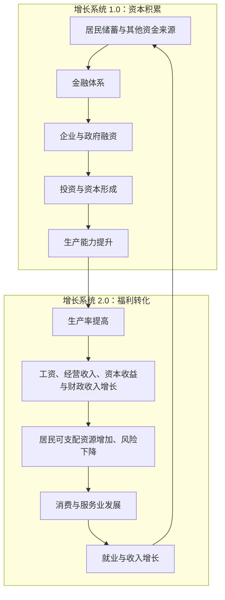
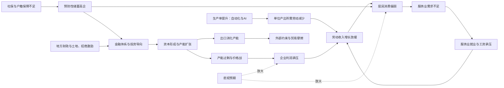

> **导读**
>
> 这篇文章整理自我与AI的一场多轮对谈。它不是观点罗列，而是一次思考实验：从一个日常现象出发，**提出假设 → 寻找证据 → 发现矛盾 → 修正判断 → 继续追问**。
>
> 我们从“为什么工作越来越难找、收入越来越难涨”开始，一路追问到产业竞争、服务业、居民消费、收入分配、储蓄与资本配置、地方财政、外部约束和社会心理，最终触及一个更大的命题：**中国过去几十年成功运行的增长模式，是否正在进入一次深刻的结构性转型？**
>
> **数据截止**：2026 年 10 月可获得的公开统计与研究。
>
> **证据边界**：文中的因果解释、“增长系统 1.0/2.0”等框架属于分析性归纳，不是官方定义，也不是经过严格计量识别的结论。不同地区、行业和人群面对的主要约束可能并不相同。
>
> **免责声明**：本文仅用于讨论经济结构，不构成任何投资、职业或政策建议。

---

## 引言：一个看似简单，却越来越难回答的问题

为什么中国近年来的工作越来越难找？为什么很多人越来越拼，收入却越来越难涨？

这是普通人每天都可能碰到的问题。刚毕业的大学生投出数百份简历，却很难得到满意的工作；有经验的白领发现招聘要求越来越高；企业不断强调降本增效；一些原本收入不错的岗位开始缩水。

但另一面同样真实。中国 GDP 仍在增长，制造业规模庞大，新能源汽车、机器人、人工智能、高端装备等产业不断取得进展，一些企业甚至在抱怨缺少技术人才。

一个矛盾由此产生：

> **为什么一个经济仍在增长、技术不断进步的国家，会让许多人感到就业越来越难、收入越来越难涨？**

最直观的解释是“经济增速下降”。但随着问题深入，我们会发现，增速只是第一层答案。在它下面，依次隐藏着名义与实际增长的落差、产业竞争方式、劳动生产率、人力资本、居民收入、资本收益、金融体系、财政制度、外部约束与社会预期。

这篇文章试图还原这一层层追问的过程。

## 追问路线图

| 层次 | 核心追问 | 认知转折 |
| :--- | :--- | :--- |
| **一、现象层** | 1. 就业难是因为增长慢吗？ | 增长与就业的联系在减弱 |
| | 2. 统计增长与个人体感为何落差这么大？ | 实际增长 ≠ 名义收入增长 |
| | 3. 增长为什么越来越不需要那么多人？ | 生产率增长可以“无就业” |
| | 4. 过去的就业发动机发生了什么？ | 创造价值 ≠ 创造岗位 |
| | 5. 企业为什么“增产不增收”，难以涨薪？ | 消耗型竞争吞噬了利润 |
| | 6. 人才越来越多，起薪为何难涨？ | 文凭供给与岗位需求错配 |
| **二、结构层** | 7. 成熟经济体靠什么容纳就业？ | 就业数量 → 就业质量 |
| | 8. 潜在服务需求为何没有变成就业？ | 需要 ≠ 有支付能力的需求 |
| | 9. 企业创造财富，居民消费为何没同步增强？ | 二次分配不是唯一答案 |
| | 10. 居民很能储蓄，财产收入为何不高？ | 储蓄 ≠ 资本剩余收益权 |
| | 11. 居民储蓄最终变成了什么？ | 分配问题 → 资本配置问题 |
| **三、制度层** | 12. 国有资本为何不能直接解决分配？ | 居民内部分配 → 部门间分配 |
| | 13. 经济系统为何天然偏向投资？ | 一套相互强化的增长体系 |
| | 14. 地方政府为何偏好投资与招商？ | 财权、事权与激励的错位 |
| | 15. 户籍和社保为何也是增长模式的一部分？ | 风险保障决定消费倾向 |
| | 16. 内需不足，能否继续靠出口消化产能？ | 大国的外部吸收约束 |
| **四、预期层** | 17. 理性的个体选择为何汇成集体困境？ | 制度通过预期起作用 |
| **五、综合层** | 18. 曾经成功的模式为何需要转型？ | 约束条件变了 |
| | 19. 能否用一次“架构升级”理解全部问题？ | 存量系统的渐进迁移 |
| | 20. 中国真正需要追求的是什么？ | 单一指标 → 多目标权衡 |

---

## 第一部分 现象层：就业与收入

### 追问 1：就业困难，真的是因为经济增长慢了吗？

最初的假设很简单：经济增长快，企业扩张，岗位增加；经济增长慢，企业招聘减少。

这显然有道理。但一组数据让这种解释变得不够充分。世界银行在 2025 年 6 月《中国经济简报》中比较了两个时期：

| 指标 | 2015—2019 年 | 2020—2024 年 |
| :--- | :---: | :---: |
| 年均 GDP 增长率 | 6.7% | 4.9% |
| 年均城镇就业增长率 | 2.7% | 0.9% |
| 五年城镇就业净增加 | 5550 万人 | 2100 万人 |

GDP 年均增速下降了约 1.8 个百分点，五年城镇就业净增量却下降了六成以上。粗略地用就业增速除以 GDP 增速，两个时期分别约为 0.40 和 0.18。

这只是描述性比较，受人口结构变化、疫情冲击、城乡就业转移等因素影响，不能当成严格的因果估计。但它至少提示了一个重要现象：

> **经济增长与就业创造之间的联系正在减弱。**

于是问题发生了变化。我们不再只问“为什么 GDP 增长得不够快”，而是开始追问：**为什么 GDP 增长已经不像过去那样，需要同步增加大量劳动者？**

不过在回答之前，还有一个更贴近日常体感的疑问需要先处理。

### 追问 2：为什么“统计上的增长”和“口袋里的体感”落差这么大？

很多人看到“GDP 增长 5% 左右”时的第一反应是：“我怎么没感觉到？”

这种落差不一定意味着统计数字有问题，而可能是因为**不同指标衡量的根本不是同一件事**。至少有三层落差值得区分。

**第一层：实际增长与名义增长。**

GDP 增速通常指实际增速，即剔除价格变化之后的产出增长。但工资、企业营收、利润、税收和债务，全部以名义金额计价。

2023 年以来，中国名义 GDP 增速持续低于实际 GDP 增速，也就是 GDP 平减指数为负；工业生产者出厂价格指数（PPI）在 2023—2025 年同比持续处于负值区间。这意味着：

- 产品的“数量”在增长，但“卖出的价格”在下降；
- 企业名义收入增长偏慢，而工资合同、租金和债务利息却是名义刚性的；
- 利润被两头挤压，企业最先压缩的往往就是招聘和涨薪。

经济学家欧文·费雪（Irving Fisher）早就描述过这种机制：价格下降时，债务的真实负担反而加重，企业和家庭被迫优先还债、削减支出，进一步压低需求和价格。这并不是说中国已陷入典型的“债务—通缩螺旋”，但它提示我们：**对于就业和收入而言，名义增长往往比实际增长更接近体感。**

**第二层：平均数与中位数。**

国家统计局公布的居民收入同时有平均数和中位数，而中位数长期低于平均数。平均数会被高收入群体拉高，中位数更接近“典型家庭”的处境。当增长成果分布不均时，“平均在增长”与“多数人感觉没变”可以同时成立。

**第三层：流量与存量。**

GDP 和收入是流量，衡量一年新增了多少；而人们的安全感很大程度上来自存量，即资产与负债。当住房等资产价格调整时，即使当年收入没有下降，家庭也会因为净资产缩水而感觉“变穷了”。这一点我们会在追问 8 中再展开。

> **小结**：体感不是“错觉”，而是我们用工资、债务和资产在感受经济，而统计公报主要报告的是实际产出。理解这种落差，是后续所有追问的起点。

### 追问 3：经济增长为什么越来越不需要那么多人？

回到主线。理解这个问题，首先需要区分经济增长的两种方式。

**第一种是增加投入**。一家工厂原来有 100 名工人，现在增加到 200 名；一家企业原来有 10 家门店，现在扩张到 100 家。生产和就业一起增长。

**第二种是提高生产率**。原来 100 名工人一年生产 10 万件产品，现在通过自动化设备、智能软件和机器人，同样 100 名工人可以生产 30 万件。产出增加了，就业人数没有增加。

经济增长可以粗略分解为：

> **总产出 = 劳动投入 × 单位劳动投入的生产率**

现实中，劳动投入还包含工时与劳动质量，增长也来自资本积累和技术进步。但这个简化模型已经揭示了一个事实：**GDP 增长并不必然意味着就业人数同比例增长**。这恰恰是工业化进入较高阶段后的常见现象。

中国早期的增长，很大程度上依靠农村劳动力向制造业转移、城市建设和劳动密集型产业扩张，这些都需要大量新增劳动力。今天的增长则越来越多地来自自动化、设备升级、技术创新与组织效率改善。

尤其是人工智能，正在把自动化从体力劳动扩展到部分知识劳动。过去企业扩大业务往往需要招聘更多普通程序员、运营、客服和设计师；现在一部分任务可以交给软件和 AI 系统。

当然，不能据此认定 AI 已经是中国近年就业增长放缓的主要原因。房地产调整、服务业需求偏弱、人口变化和企业预期同样重要，而且 AI 也会创造新任务和新职业。但从长期看，一个新的矛盾值得认真研究：

> **技术越成功，单位产出所需的劳动可能越少；而社会仍然需要为绝大多数人提供收入来源。**

那么问题就来了：如果制造业越来越自动化，它原来承担的大规模就业功能，应当由谁接替？

### 追问 4：过去的就业发动机正在发生什么变化？

回顾过去几十年，中国曾经有三台非常强大的就业发动机。

1. **工业化**：大量农村人口进入工厂，纺织、电子装配、机械、家电、轻工业和出口产业吸收了数以千万计的劳动者。
2. **房地产与城市化**：它不仅创造建筑岗位，还带动建材、家具、装修、家电、中介、金融、设计、物流和地方基础设施投资，实际上是一个横跨许多行业的就业集群。
3. **互联网与现代商业扩张**：电商、移动互联网、平台经济、金融科技、广告与软件开发快速发展，创造了大量城市白领岗位。

今天，三台发动机都在变化：传统制造业向高端制造和自动化转型；房地产结束了持续高速扩张的阶段；互联网企业从追求规模转向利润、效率和技术能力。

与此同时，劳动力供给本身也在变化。过去农村富余劳动力源源不断进入城市，压低了工资、支撑了劳动密集型产业；随着劳动年龄人口总量下降、城镇化放缓，这种“无限供给”的条件正在减弱。学界对中国是否已越过“刘易斯拐点”仍有争论，但劳动力供给结构的变化本身已经很清楚。

这并不意味着制造业和技术产业不再重要。恰恰相反，它们仍具有重要的战略价值。但必须区分两个概念：

> **创造更多经济价值，与创造更多就业岗位，不是同一件事。**

一家高度自动化的高端制造企业，可能创造巨大的增加值，却未必像过去的劳动密集型工厂那样吸收大量工人。

在追问成熟经济体如何解决这一矛盾之前，还有两个“近距离”的问题需要回答：企业为什么不涨薪？劳动者为什么越来越多却越来越不值钱？

### 追问 5：企业为什么“增产不增收”，难以给员工涨薪？

一个常见的直觉是：竞争越激烈，效率越高，经济越好。但近年很多行业出现了一种奇怪的现象——**产量在增长，技术在进步，企业却普遍不赚钱。**

我们先看企业在价值链中的位置：

| 价值链环节 | 典型代表 | 附加值与定价权 | 就业吸纳 |
| :--- | :--- | :--- | :--- |
| 研发、核心技术、标准 | 芯片架构、基础软件、关键材料 | 附加值高，定价权强 | 以高技能人才为主，人数有限 |
| 制造、组装、代工 | 通用设备、消费电子组装、纺织服装 | 附加值低，对成本高度敏感 | 吸纳大量就业 |
| 品牌、渠道、全球服务 | 国际品牌、全球分销与售后网络 | 附加值高，掌握终端溢价 | 中等规模，偏专业服务 |

这就是常说的“微笑曲线”。许多企业仍集中在曲线底部的制造环节。当外需放缓或面临关税壁垒时，它们很难通过提价转移成本，只能压缩人力成本、延长工时来维持微薄利润。

但这还不足以解释为什么一些高技术行业（如光伏、锂电、新能源汽车）也陷入价格战。这里需要区分两种竞争：

- **效率型竞争**：低效企业被淘汰、退出，产能出清，留下的企业获得合理利润，并有能力投资和涨薪；
- **消耗型竞争**：由于地方招商补贴、银行续贷、保就业等原因，低效产能难以退出，所有企业一起降价，直到整个行业都接近亏损。

关键差别不在于竞争是否激烈，而在于**退出机制是否顺畅**。当退出被阻断，竞争就从“优胜劣汰”变成“共同失血”。近年政策文件已明确提出要综合整治“内卷式竞争”，正是对这一问题的回应。

价格战的收益去了哪里？一部分流向了国内消费者，一部分以更低的出口价格流向了海外买家（这一点我们在追问 16 中继续讨论）。而留在生产者手中的利润越来越薄，员工工资自然缺乏上涨空间。

此外，技术升级中的“机器换人”提高了企业产值，却可能减少劳动在新增收益中的分配份额。这为后面讨论“生产率红利归谁”埋下了伏笔。

### 追问 6：人才越来越多，起薪为何难涨？

这是一个从劳动力供给侧提出的问题。

中国高校毕业生规模已超过 1200 万人。按照朴素的想法，受过高等教育的劳动者越多，整体生产率和收入应该越高。但现实中，很多年轻人感到学历越来越“不值钱”。

**第一个解释：文凭的信号价值在递减。**

经济学家迈克尔·斯宾塞（Michael Spence）的信号理论认为，学历除了代表技能，还是一种向雇主证明自身能力的“信号”。当高学历变得普遍，信号的区分度就会下降：过去大专可以胜任的岗位，如今要求本科甚至研究生，但岗位本身创造的价值并没有增加，工资自然不会因学历提高而上涨。这被称为“文凭通胀”。

**第二个解释：供给结构与需求结构错配。**

```
【供给端】大量高校毕业生 → 期望体面、稳定的白领与知识型岗位
                   ▲
                   │  结构性错配
                   ▼
【需求端】部分高技能技工、专业服务岗位短缺；通用白领岗位相对过剩
```

一边是“人找不到工作”，另一边是“工作找不到人”。高级技工、设备维修、护理康复等岗位长期短缺，但这些岗位的收入、社会认同和职业发展路径，并没有让年轻人觉得“值得去”。

**第三个解释：职业生命周期被压缩。**

当更年轻、成本更低、愿意加班的劳动者持续进入市场，而企业又缺乏为经验付费的利润空间时，雇主的短期理性选择往往是替换资深员工，而不是为工龄买单。“35 岁门槛”背后，是劳动力供给充裕与企业利润承压的共同作用。

> **更深一层的问题**：教育扩张本身没有错。真正需要追问的是——经济结构能否创造足够多需要高技能、并愿意为高技能付费的岗位？这又把我们推回到需求侧：那些岗位应该从哪里来？

---

## 第二部分 结构层：服务业、消费与分配

### 追问 7：美国、日本、德国靠什么容纳庞大的就业人口？

这是整个思考过程中的一个重要转折。

我们习惯把德国、日本视为制造强国。但查看就业结构会发现：德国 2025 年约 75.9% 的就业人口在服务业；日本 2024 年约 74.2% 在第三产业；美国 2024 年的对应比例约为 80%。中国 2024 年第三产业就业占比为 48.8%。

各国统计分类存在差异，数字不能机械比较，但方向十分清楚：**成熟经济体的大多数劳动者，并不直接从事制造业**。他们分布在医疗、教育、养老、护理、金融、软件、企业服务、咨询、科研、物流和文化等领域。

这给了我们一个新的理解框架。制造业创造技术优势、出口收入与高生产率；围绕这些活动又会产生研发、设计、咨询、售后、金融和商务服务需求。同时，社会变富以后，人们对医疗、教育、旅游、养老、娱乐和健康服务的需求也会增加。成熟经济体的就业结构，逐渐从单一的制造业吸纳，变成多样化的服务业吸纳。

**一个容易被忽视的机制：鲍莫尔成本病。**

经济学家威廉·鲍莫尔（William Baumol）指出：一支弦乐四重奏在 200 年前需要 4 个人演奏 40 分钟，今天依然如此，它的“生产率”几乎没有提高；但音乐家的工资却随整个社会一起上涨了。原因是制造业生产率提升抬高了全社会的工资水平，服务业必须支付相近的工资才能留住人。

这意味着两件事：

1. 制造业生产率越高，劳动力就越会向服务业转移，服务业就业占比上升是一种规律；
2. 护理、教育、医疗等服务会变得**相对越来越贵**，它们能否形成大规模就业，取决于整个社会是否有足够的收入去购买。

但这个答案很快又暴露出一个漏洞：**服务业就业多，就一定意味着中产阶层庞大吗？**

显然不是。送外卖是服务业，软件咨询也是服务业；普通餐饮是服务业，专业医疗也是服务业。它们的生产率、收入、社会保障和职业发展空间差别巨大。因此，我们真正需要关注的不只是服务业规模，而是：

> **能否形成大量具有稳定收入、职业技能、社会保障和成长路径的现代服务业岗位。**

这也是德国职业培训体系值得研究的原因。它的经验并非鼓励所有人进入大学，而是让技术工人、维修人员、护理人员等职业具备清晰的资格认证、培训体系和职业发展路径。社会需要的不是每个人都从事高科技研发，而是让更多普通工作有机会成为稳定、体面的专业职业——这也正是对追问 6 中“技工岗位缺人却没人愿意去”的回答。

由此又出现一个新问题：**中国有庞大的人口市场和不断增加的服务需求，为什么服务业没有更充分地承接制造业和房地产释放出来的劳动者？**

### 追问 8：为什么潜在服务需求，没有充分变成实际就业？

这里需要引入一个重要区别：

> **需要，不等于有支付能力的需求。**

假设一个家庭需要养老护理服务。它确实有需求。但如果家庭收入不高、未来医疗费用不确定、养老金保障不足，它可能不愿长期支付专业护理费用。结果是：老人需要护理，护理机构需要客户，年轻人需要工作——三种需要同时存在，却不一定能形成可持续的市场交易。

类似情况也出现在托育、心理健康、康复、职业培训和文化娱乐等领域。结合鲍莫尔成本病，这个问题更加清晰：**服务越依赖人工，就越昂贵；越昂贵，就越依赖居民收入和支付意愿。**

**资产负债表的冲击。**

在收入之外，家庭资产的变化同样影响支付意愿。世界银行的研究指出，住房和银行存款在中国居民资产中占比很高。过去，房价上涨创造了“财富增值”的预期，支撑了消费和借贷意愿；当房价调整时，资产端缩水，而房贷等负债却是刚性的，家庭的净资产随之下降。

行为经济学中的“损失厌恶”（Loss Aversion，卡尼曼与特沃斯基）提示，人们对损失的感受通常强于同等规模的收益。因此可以提出一个有待检验的假说：**资产价格下跌对消费的抑制，可能比此前上涨时对消费的刺激更强。**

当家庭的目标从“追求收益最大化”转向“负债最小化”——提前还贷、削减开支、增加存款——单个家庭的选择是理性的，但会形成一个负反馈：


一个人的支出就是另一个人的收入。依赖消费支出的服务业，恰恰是吸纳城镇就业的主要蓄水池。

这也解释了为什么社会保障与就业并不是两个彼此独立的政策领域。可靠的医疗、养老、失业和教育保障，不仅改善生活质量，也可能降低家庭的预防性储蓄，从而支持消费。

我们原本关注的是“企业为什么不招聘”，现在开始关注：**为什么居民没有形成足够强、足够稳定的消费需求，让企业愿意扩大招聘**？于是我们接近了收入分配问题。

### 追问 9：既然企业能够创造财富，为什么居民消费能力没有同步增强？

问题似乎指向一个熟悉的答案：资本收益集中。

假设 AI 让一家企业的产出明显提高，而雇佣人数减少。新增收益可能分配给劳动者、企业所有者和政府，也可能用于偿还债务或继续投资。如果劳动收入增长缓慢，收益更多体现为资本回报，那么主要依靠工资生活的家庭，就无法按相同比例分享技术进步。

这引出一个非常重要的问题：

> **技术进步创造的生产率红利，究竟通过什么渠道进入普通家庭？**

至少有三条渠道：

1. **初次分配**：劳动者获得工资，企业和资本所有者获得利润。如果市场竞争充分、劳动者技能稀缺、企业愿意分享红利，工资可以随生产率增长；但如果劳动者议价能力弱，或部分行业存在显著的市场支配力，新增收益就可能更多留在资本端。
2. **资本所有权**：普通家庭不一定只能依赖工资。养老金、企业年金、投资基金和直接持股，都可以让居民分享企业利润与长期资本回报。
3. **二次分配**：通过税收、社会保障和转移支付，对市场分配结果进行调整。医疗、教育和其他公共服务也会直接影响居民的实际生活资源。

于是，我们最初关于分配的理解被修正了：**二次分配很重要，但不是唯一的解决办法，也不能替代初次分配、广泛的资本所有权和有效的公共服务**。如果初次分配持续失衡，完全依靠事后税收和补贴纠正，不仅财政压力大，也可能忽略竞争、就业和资本所有权结构本身的问题。

真正需要讨论的是：**普通家庭能否通过工资、经营收入、资本收益和公共保障，多渠道地分享经济增长。**

但紧接着，一个看似矛盾的事实让问题变得更有趣。

### 追问 10：中国居民明明很能储蓄，为什么资本性收入却不高？

2025 年，全国居民人均可支配收入为 43,377 元。其中工资性收入 24,555 元，财产净收入只有 3,490 元，约占全部可支配收入的 8%。

与此同时，中国居民持有大量银行存款和住房资产。为什么家庭积累了相当多的财富，却没有获得相应规模的持续性财产收入？

答案隐藏在两个容易混淆的概念中：

> **拥有储蓄，不等于拥有生产性资本的剩余收益权。**

假设一个家庭有 100 万元：

- 存进银行，家庭获得的是对银行的**债权**，收益主要是利息；
- 购买企业股权，家庭拥有的是对未来利润的**剩余索取权**，同时承担经营风险。

两者风险与收益结构完全不同。存款有流动性和安全性优势，股权可能获得更高长期回报，也可能出现损失。所以，不能简单认为“存款收益低就是收益被不合理地拿走”。更深层的区别在于：**家庭承担什么风险、拥有何种金融权利、最终能分享什么收益。**

世界银行 2025 年关于中国居民储蓄的研究指出，预防性储蓄、长期金融工具供给不足以及房地产市场调整，都影响着居民的资产选择。一个家庭可能拥有价值很高的房产和大量存款，却仍然缺少稳定的财产性现金流。

房地产过去在一定程度上同时承担了家庭储蓄、投资和养老保障的多重功能。当房价上涨预期改变后，家庭转而增加低风险储蓄，同时进一步压缩消费。

新的问题随之出现：**居民大量储蓄形成的金融资源，究竟通过金融体系流向了哪里？**

### 追问 11：居民储蓄最终变成了什么？收益归谁？

可以画出一条简化的资金链路：

> **居民金融储蓄 → 金融体系 → 企业和政府融资 → 生产性投资、基础设施与其他资产**

需要强调，这只是资金配置示意，不是银行运行的精确模型。现代银行能够通过信贷创造存款，不能机械理解为“必须先收到存款才能放贷”。但在经济结构上，这个模型仍有解释力。

此时需要同时追问三个问题：

1. 投资形成的资产是否有价值？
2. 资产的经济回报有多高？
3. 最终拥有资产收益权的是谁？

在资本稀缺的工业化初期，大量储蓄转化为工厂、公路、电力和港口，带来了巨大的生产率改善，这是中国过去几十年资本积累的重要基础。但当基础设施和工业资本已经高度积累后，追加投资的边际回报可能下降。

如果储蓄继续大量转化为低回报项目，就可能出现一种令人担忧的局面：

> **居民减少了今天的消费，却没有换来足够高的未来收入增长。**

这并不意味着投资本身是坏事。先进制造、能源、科研和关键基础设施仍然需要投资。真正变化的是：**不同投资方向的边际社会回报不再相同。**

问题由此从收入分配升级为资本配置：经济不仅要讨论财富如何分配，还要讨论社会储蓄形成了什么资产，这些资产创造的收益能否补偿其成本和风险。

---

## 第三部分 制度层：资本、财政与外部约束

### 追问 12：既然国有资本属于公共部门，为什么它不能直接解决分配问题？

中国经济有一个必须单独讨论的特殊因素：**国有资本。**

私人资本的收益主要归股东所有；国有资本具有公共所有权性质，其收益可以通过利润上缴、税收、社会保障和公共财政服务社会。从理论上看，它为社会分享生产性资产收益提供了另一种制度渠道。

但这里存在一个容易被忽视的区别：

> **公共所有权，不等于居民即时获得现金流。**

国有企业获得利润后，可以留存、研发或再投资，也可以上缴国有资本收益，部分资金再通过财政预算支持公共服务。这些用途的经济功能各不相同。

财政部 2025 年预算执行数据显示，全国国有资本经营预算收入约 8,547 亿元，其中中央国有资本经营预算向一般公共预算调入 2,400 亿元。这说明国有资本收益确实有一部分进入了公共财政，不能简单断言“国企利润没有回到社会”。

真正值得研究的是下一步：多少收益继续用于资本形成？多少用于公共服务、社会保障和提高居民实际可支配资源？而且国企还通过税费等渠道贡献财政收入，不能对单一预算项目作过度推断。

讨论到这里，我们意识到，把问题完全归结为“富人与穷人如何分配”还不够。中国经济还存在另一个维度：

> **居民部门、企业部门与政府部门之间，收入、资产和支出责任如何分配。**

这与居民内部的收入不平等不是同一个问题。即使居民内部差距没有明显变化，如果更多资源留在企业和政府的投资循环中，而家庭可支配资源增长较慢，居民消费仍然会受到约束。

那么，为什么过去中国的经济资源会形成较强的投资导向？

### 追问 13：为什么中国过去几十年的经济系统天然偏向投资？

这里，讨论发生了最重要的一次视角转变：我们不再只讨论企业、工资和消费，而开始研究**中国经济为什么形成了这样一套资金配置与增长机制。**

回到改革开放初期，答案并不难理解：当时最缺的是资本。道路、电力、港口、机器、住房、工厂和通信设施都存在巨大缺口。把一部分当期资源用于投资，可以显著提高未来的生产能力。高储蓄、高投资和快速资本积累，在那个阶段具有很强的经济合理性。

中国逐渐形成了一套相互配合的机制：

- 居民储蓄为金融体系提供稳定资金；
- 银行体系支持企业与基础设施融资；
- 地方政府通过招商引资、园区建设和基础设施投资扩大经济活动；
- 城镇化、房地产与土地收入、地方财政紧密联系；
- 企业扩张创造就业、税收和收入，进一步支持储蓄和投资。

这不是几项彼此独立的制度，而是一套相互强化的增长体系：

> **储蓄 → 融资 → 投资 → 资本形成 → 生产能力 → 经济增长 → 再投资**

这是一套高度有效的资本积累机制。但它有一个重要前提：**继续扩大资本存量，仍然能够带来足够高的经济和社会回报**。当这一前提改变时，原有机制就可能需要调整。

### 追问 14：地方政府为什么对投资和招商有较强的激励？

讨论制度结构时，地方财政是一个绕不开的环节。

2025 年，中国地方一般公共预算支出约 24.44 万亿元，占全国一般公共预算支出的 85%；地方本级一般公共预算收入约 12.21 万亿元，中央向地方转移支付约 10.19 万亿元。

这些数字不能直接相减计算财政缺口，因为还涉及其他预算调入、结转资金和地方债务安排。但它们反映出：**地方承担了大量支出责任，其财政运行高度依赖中央转移支付和多种筹资渠道。**

地方政府既要提供教育、医疗、社保等公共服务，又要维持基础设施和经济发展。在高速工业化和城镇化时期，引进工厂、建设园区和基础设施，往往能较快扩大地方税基和就业；相比之下，提高居民长期养老保障或增加公共服务供给，会形成长期的持续支出义务，收益却更加分散，甚至体现在其他地区或未来年度。

这会形成不同的财政激励。土地开发又进一步强化了投资循环：

> **城市建设 → 土地开发和出让 → 财政资源 → 基础设施 → 更多经济活动**

但房地产调整以后，这条链路面临明显压力。2025 年地方国有土地使用权出让收入约 4.15 万亿元，同比下降 14.7%，原有的部分融资方式正在失去扩张能力。

这里还可以与追问 5 连接起来：地方之间的招商竞争，以及为保住本地企业和就业而提供的补贴与融资支持，正是一些行业“产能难以退出”的制度根源之一。**地方的局部理性，可能叠加成全国层面的产能过剩。**

一个更深刻的问题由此出现：如果未来城市发展的重点从“建设更多城市资产”转向“为已有居民提供更高质量的生活”，地方财政结构是否也需要同步调整？这不是简单增加或减少支出，而是财权、事权与财政激励如何协调的问题。

### 追问 15：户籍和社会保障为什么也属于增长模式的一部分？

乍一看，户籍、养老保险、医疗保障与经济增长属于不同领域。但它们与居民储蓄、人口流动和服务消费紧密相连。

一个在城市工作的劳动者，如果未来的养老、医疗、子女教育和失业保障存在较大不确定性，就会倾向于保留更多储蓄。从个人角度看，这是合理的风险管理；但如果大量家庭同时提高预防性储蓄，消费需求就会受到影响。

与此同时，流动人口在城市获得更多公共服务，通常需要迁入地政府承担成本。于是形成一个典型的财政协调问题：

> **人口流动带来的生产率和消费收益具有广泛性，但部分公共服务成本由迁入地承担。**

如果财政安排不能充分匹配，公共服务均等化就会面临实施障碍。

由此我们发现，户籍、社保、地方财政与消费并不是相互独立的问题，而是在同一条因果链上：

> **社会保障覆盖与可携带性 → 家庭风险预期 → 储蓄与消费 → 服务企业收入 → 就业与工资**

当然，社会保障不足并不是高储蓄的唯一原因，人口年龄结构、收入增长预期、住房配置、教育成本和投资渠道同样在起作用。但这已经足以说明：**一次性刺激消费，与调整长期制度安排，可能产生完全不同的效果。**（这一点在追问 17 中会得到更系统的解释。）

### 追问 16：如果国内需求不足，为什么不能继续依靠出口消化产能？

前面的讨论几乎都在国内循环中打转，但还有一个绕不开的外部问题：既然国内消费偏弱，把多余的产能卖到海外不就可以了吗？

过去，出口确实是中国经济的重要“泄压阀”。但这条路径面临一个大国特有的约束：

**小经济体可以靠出口增长，大经济体的出口会改变世界价格。**

当一个经济体的制造业规模占全球相当大的份额时，它的产能扩张会直接压低国际市场价格，挤压其他国家的产业和就业。贸易伙伴的反应往往是关税、反补贴调查和供应链“去风险”。外部世界的吸收能力，本身就是一个硬约束。

**更深一层：价格战式出口，可能是一种“收入外流”。**

如果企业靠不断降价维持出口份额，那么生产率提升的成果，有相当一部分以更低价格的形式转移给了海外消费者，而不是留在国内员工和企业手中。经济学用“贸易条件”描述这种现象：同样数量的出口，能换回的进口越来越少。

这意味着，经济再平衡不仅是一个国内分配问题，也是一个国际约束问题：

> **国内需求扩张的速度，需要跟上生产能力扩张的速度；否则，过剩产能要么在国内表现为价格战和利润萎缩，要么在国外表现为贸易摩擦。**

这也让我们对追问 5 中的“内卷”有了新的理解：它不只是企业之间的竞争问题，而是整个经济系统供给能力与有效需求之间失衡的微观表现。

---

## 第四部分 预期层：社会心理如何放大结构问题

### 追问 17：为什么每个人的理性选择，会汇聚成集体的困境？

到这里，我们已经讨论了大量制度和结构。但一个问题仍然没有回答：**同样的制度条件下，为什么经济有时充满活力，有时却陷入停滞**？答案的一部分在于预期。

**机制一：囚徒困境式的“预防性内卷”。**

每个人都知道，所有人都加班并不会让整个群体的收入增加；但只要别人加班，自己不加班就可能被淘汰。在资源存量博弈中，个体的理性自保——牺牲闲暇、压低薪资要求、过度工作——在宏观上汇聚成集体的“高强度、低溢价劳动”。企业层面的价格战（追问 5）和地方层面的招商竞争（追问 14），本质上是同一种博弈结构。

**机制二：节俭悖论。**

凯恩斯提出：对单个家庭来说，多储蓄是美德；但如果所有家庭同时增加储蓄、减少消费，总需求下降，收入随之减少，最终全社会的储蓄未必增加，反而所有人都更穷了。追问 8 中的负反馈循环，就是节俭悖论在中国服务业中的具体表现。

**机制三：习得性无助与防御性悲观。**

心理学家塞利格曼（Martin Seligman）发现，当努力反复得不到正反馈，个体会逐渐停止尝试。当换工作、考证、创业都没有带来收入改善时，人们会退守到“求稳”，甚至转向“低欲望”。这种微观心理汇总起来，就表现为全社会创业意愿、消费意愿和冒险精神的下降。

**机制四：预期的自我实现。**

凯恩斯所说的“动物精神”、索罗斯所说的“反身性”都指向同一件事：如果企业普遍预期需求疲软，就会减少投资和招聘，需求因此真的疲软；如果家庭普遍预期收入下降，就会减少消费，收入因此真的下降。**悲观预期不只是对现实的反映，它也在塑造现实。**

**这对政策意味着什么？**

米尔顿·弗里德曼的“永久收入假说”给出了一个重要提示：家庭的消费主要取决于对长期收入的预期，而不是一次性的收入变化。因此：

- 一次性发放的消费券或补贴，很大一部分可能被储蓄起来；
- 而可信、可持续的制度承诺——例如稳定的养老金预期、可携带的医疗保障、可预期的公共服务——即使当期金额不大，也可能改变家庭的长期风险判断，从而释放消费。

> **小结**：制度不仅通过直接的收入转移起作用，更通过改变人们对未来的预期起作用。打破负反馈循环，关键在于重建“努力会有回报、风险有人兜底”的可信预期。

---

## 第五部分 综合层：增长模式的转型

### 追问 18：原来的增长模式曾经成功，为什么现在需要讨论转型？

一种制度曾经取得巨大成功，并不能保证它在所有发展阶段都保持同样的边际效率。

资本稀缺时，新建基础设施和工厂回报很高；当资本逐渐丰富，某些领域继续追加投资的回报就可能下降。与此同时，居民对养老、健康、托育、教育、文化和专业服务的需求不断增加。社会面临的主要约束发生了变化。

过去，发展首先需要解决的是：**如何更快地扩大生产能力？**

未来，越来越需要同时解决：**如何提高生产率，并让生产率增长形成稳定的居民收入、消费需求和高质量就业？**

这并不意味着要放弃制造业投资。中国仍然需要技术研发、高端制造、能源与数字基础设施和大量其他生产性投资。真正需要改变的是**资源配置时考察的目标**：过去，一项投资是否增加固定资产、产值和 GDP 是重要标准；未来还需要更充分地考虑长期资本回报、财政可持续性、人力资本、就业质量、风险保障和居民福利。

例如，建设电网是投资；提高儿童托育和教育质量，也可能提高未来的劳动参与率和人力资本。建设先进制造工厂可以提高生产率；改善慢性病管理和老年康复，同样可能降低社会成本，并创造专业化就业。

**投资于人和投资于物，并不必然对立**。经济转型不是从投资完全转向消费，而是逐渐建立一套能够同时优化生产率、居民福利、就业和长期资本回报的资源配置机制。

### 追问 19：能不能用一次“经济架构升级”来理解全部问题？

如果从系统工程的角度重新审视前面的探索，可以把中国的增长机制抽象为两个相互关联的系统：



- **增长系统 1.0** 的主要功能是资本积累，它极大地推动了中国的工业化；
- **增长系统 2.0** 的主要功能，是把生产率转化为居民福利和国内需求。

两套系统都不可缺少。只有资本积累而缺少最终需求，就会面临投资回报下降、行业供需失衡和消费偏弱；只扩大消费而缺少生产率提升和有效投资，长期收入增长同样难以持续。真正需要寻找的，不是用第二套系统替代第一套，而是**让资本积累、技术进步、收入分配、社会保障和居民消费形成更可持续的循环。**

值得注意的是，这种转型具有强烈的路径依赖。大量企业、地方财政安排、金融资产与负债，以及就业岗位，都建立在原有模式之上。如果投资突然收缩，而居民消费和服务业尚未形成足够的承接能力，经济首先遭受的会是需求和就业冲击。

所以从系统架构角度看，这是一次**存量系统的渐进式迁移，而不是推倒重来**——就像软件工程中给一个仍在高负载运行的核心系统做架构升级：不能停机，只能一边运行一边替换模块。

### 追问 20：那么，中国真正需要追求的是什么？

走到这里，我们必须对前面的分析再提出一次质疑：**如果居民消费很重要，是不是消费占 GDP 的比例越高越好？**

也不能这样简单判断。美国拥有高度发达的服务经济，同时也面临居民债务、财政赤字和收入不平等等问题；德国和日本的产业结构、储蓄习惯、公共服务体系与外部经济关系又各不相同。成熟经济体之间，并不存在一个统一的“最优”消费与投资比例。中国仍处于技术升级与人口老龄化并行的阶段，仍需持续投资。

因此，提高居民消费占比可以是经济再平衡的重要方向，但不能把某个国际平均比例机械地当成唯一目标。真正值得考察的是更深层的经济结果：

- 经济增长能否创造持续的居民收入？
- 劳动者能否分享技术进步？
- 居民是否需要为养老、医疗和失业承担过高的不确定性？
- 大量储蓄是否转化为具有合理回报的资产？
- 国有和私人资本收益能否通过适当渠道改善居民福利？
- 服务业能否形成大量稳定、专业化的中等收入岗位？
- 中央与地方财政安排能否支持公共服务和人口自由流动？

这些问题的答案，比 GDP 增速或消费率的单个数字更有解释力。

世界银行和 IMF 近年的中国经济研究，都将就业结构、消费、社会保障、资本配置效率和财政制度放在重要位置，并提出了扩大社会保障、改善资本市场、减少低效率投资等建议。但具体政策如何组合、以什么节奏推进、财政成本如何承担，仍然需要认真权衡：

| 政策方向 | 潜在收益 | 需要权衡的约束 |
| :--- | :--- | :--- |
| 提高国有资本收益上缴比例 | 扩大公共财政资源 | 企业合理投资与偿债需要 |
| 发展居民长期权益投资 | 让居民分享资本收益 | 公司治理、市场透明度与投资者保护；不能把居民推向不适合其风险承受能力的资产 |
| 扩大社会保障 | 降低家庭风险、释放消费 | 长期财政可持续性 |
| 减少低效率投资 | 改善资源配置 | 调整过快可能引发就业与金融风险 |
| 畅通落后产能退出 | 终结消耗型竞争、修复利润 | 短期就业冲击与地方财政压力 |

经济转型的困难，恰恰在于**许多目标都合理，却无法脱离约束条件单独实现。**

---

## 回到个人：理解这些宏观逻辑，对普通人意味着什么？

宏观分析无法直接让任何人涨薪，但它至少可以帮助我们做出更清醒的判断。以下只是思考方向，不构成具体建议：

1. **区分周期性压力与结构性变化**。前者可能随经济回暖缓解，后者则意味着某些岗位和路径本身在缩小。如果你所在的行业正处于“旧就业发动机”之中，值得提前思考技能迁移。
2. **关注“有支付能力的需求”在哪里**。结合追问 7 和 8，养老、健康、专业技术服务等领域的长期需求明确，但能否成为好职业，取决于支付体系和职业认证的完善程度，需要保持观察。
3. **寻找与 AI 互补、而非被 AI 替代的位置**。AI 擅长标准化的知识任务；需要判断力、跨领域整合、人际信任和现场责任的工作，短期内更难被替代。把 AI 当成杠杆，而不是对手。
4. **重视资产负债表的韧性**。在名义收入增长放缓、资产价格波动的环境下，过高的杠杆会放大风险。现金流的稳定性，往往比账面资产更重要。
5. **警惕被情绪化叙事牵引**。很多焦虑来自把结构性问题归咎于个人失败，或者反过来把个人选择完全归咎于环境。理解系统，是为了在系统中更理性地行动。

---

## 结语：从就业困难，到增长模式的底层结构

回头看最开始的问题——为什么就业越来越难、收入越来越难涨——我们的认识经历了数次变化：

- 最初，我们认为是**经济增速下降**；
- 随后发现，**GDP 增长与就业增长的联系在减弱**，而且名义增长与实际增长的落差进一步削弱了收入体感；
- 于是追问**劳动生产率、自动化与旧产业的就业吸纳能力**，并发现**消耗型竞争**吞噬了企业的涨薪空间，**文凭通胀**削弱了学历的回报；
- 接着发现，成熟经济体真正容纳大量就业的，是**多样化的现代服务业**；
- 追问服务业为何没有充分发展，问题转向**居民收入、资产负债表与消费**；
- 追问居民消费，又涉及**初次分配、资本所有权、二次分配和社会保障**；
- 研究资本收益时，我们发现**居民储蓄与拥有生产性资本权益不是一回事**；
- 继续追问储蓄的去向，问题转向**金融体系、资本配置和投资边际回报**；
- 引入国有资本后，又发现**公共所有权、财政收入和居民实际获得收益**之间存在不同的传导渠道；
- 之后追到**地方财政、土地制度、户籍社保与增长激励**，以及大国面临的**外部吸收约束**；
- 最后发现，所有这些结构问题，又会通过**社会预期与集体心理**被放大或缓解。

这些看似独立的问题，逐渐连接成一张因果网络：



但必须注意：这是一组相互作用的反馈机制，而不是已被严格计量研究证明的单一因果链。不同地区、行业和人群面对的主要约束可能并不一样。

这正是不断追问的意义。我们不再满足于找到一个能解释现象的原因，而是继续问：这个原因本身又由什么决定？有没有其他解释？什么数据能够支持或推翻我们的判断？

最终得到的不是“只要实施某项政策，所有问题就能解决”的简单答案，而是一个更有价值的理解框架：

> **中国过去几十年的核心任务，是高效率地把储蓄和其他经济资源转化为资本、生产能力和经济增长。未来需要进一步解决的，是如何让持续的技术进步和资本积累，更充分地转化为居民收入、公共保障、现代服务需求与高质量就业。**

前者解决的是一个社会如何快速工业化；后者关乎一个已经拥有庞大工业体系的社会，如何持续形成广泛而稳定的繁荣。两个任务并不对立，但它们要求经济系统具备不同的能力。

回到就业问题本身，可以提出一个有待进一步检验的核心命题：

> **中国当前部分就业与收入压力，可能不仅来自经济周期，也来自生产率与资本积累能力的提升速度，与居民收入、现代服务业和高质量岗位生成机制的调整速度之间的不匹配。**

如果这一判断成立，解决就业问题就不只是增加招聘岗位，而需要同时关注劳动收入、资本配置、现代服务业、社会保障、财政制度以及社会预期的协调演进。

---

## 留给下一次对谈的问题

探索还没有结束。以下是这次对谈中浮现、但尚未充分展开的问题，也是「硅基问道」后续想继续追问的方向：

1. **AI 时代的劳动收入份额会怎样变化**？如果 AI 主要替代的是知识劳动，那么“以工资为核心”的分配体系是否需要补充？主权财富基金分红、全民持股计划、基本收入等方案，各自的代价是什么？
2. **老龄化会自然降低储蓄率吗**？生命周期假说预测老年人会消耗储蓄，但中国的老年家庭储蓄率并不低。是社保不足、代际转移，还是文化习惯在起作用？
3. **如何区分“好的价格下降”和“坏的通缩”**？技术进步带来的降价提高了实际购买力，需求不足带来的降价则损害收入和就业。当 PPI 长期为负时，我们该用什么指标区分二者？
4. **“投资于人”的回报如何进入考核体系**？托育、教育、医疗的长期回报难以在一个任期内体现，地方政府的激励机制应该如何改变，才能让它们与修路建厂“公平竞争”？
5. **内需扩张能否跑赢产能扩张**？在外部约束日益收紧的情况下，国内消费的增长速度需要达到什么水平，才能吸收不断提升的生产能力？
6. **如何让技工、护理、维修成为“体面职业”**？这需要资格认证、行业定价、社会保障与社会认同的共同改变，其中哪一个才是真正的瓶颈？
7. **是否存在“一国多路径”**？东部沿海、中西部与东北地区的约束条件差异很大，统一的转型叙事是否掩盖了地区间完全不同的问题？
8. **14 亿人口的“最优结构”是什么**？对于一个人口庞大、制造业规模巨大、进入老龄化并仍处于技术追赶中的经济体，怎样的消费、储蓄、投资和公共服务结构，才能形成长期可持续的增长与就业？

---

## 附记：这次和 AI 一起思考，我学到了什么

作为「硅基问道」栏目的第一篇文章，我想记录一些关于“如何与 AI 一起思考”的体会。

**三个最有价值的认知转折：**

1. 从**就业数量**转向**就业质量**：问题不是岗位够不够，而是能否形成大量稳定、体面、有成长路径的岗位；
2. 从**居民内部的贫富分配**转向**居民—企业—政府的部门间分配**：即使贫富差距不变，资源在部门间的配置也会决定消费能力；
3. 从**单一经济政策**转向**相互耦合的制度架构**：就业、消费、社保、财政和金融是一张网，任何单点调整都会牵动整体。

**与 AI 对谈的几点方法：**

- **让 AI 先给框架，再逐层质疑框架**。AI 很擅长快速给出一个“看起来完整”的解释，但真正的收获来自追问“这个解释的漏洞在哪里”。
- **要求区分描述性相关与因果推断**。文中多处“这只是描述性比较”“有待检验的假说”，正是在对谈中反复要求 AI 澄清的结果。
- **所有数字都要回到原始来源核验**。这篇文章的早期版本中，AI 曾给出一些看似精确、但无法溯源的数据（例如各价值链环节的利润率区间），在修订时已全部删除或改为定性描述。AI 是很好的思考伙伴，但不是可靠的统计数据库。
- **让 AI 反驳自己**。每当得出一个结论，就问一句“如果这个判断是错的，最可能错在哪里”。追问 20 对“消费率越高越好”的反思，就来自这样的提问。

---

## 主要参考资料

本文以截至 2026 年 10 月可获得的公开统计与研究为依据。文中的因果解释和“增长系统 1.0/2.0”等框架属于分析性归纳，不应视为官方定义或已获严格因果识别的结论。

- [世界银行：《China Economic Update — June 2025》](https://thedocs.worldbank.org/en/doc/8ae5ce818673952a85fee1ee57c3e933-0070012025/original/CEU-June-2025-EN.pdf)，重点参考 Jobs in Transition，用于分析经济增长与就业创造之间关系的变化。
- [世界银行：《China Economic Update — December 2025》新闻稿](https://www.worldbank.org/en/news/press-release/2025/12/11/advancing-reforms-can-enhance-prospects-china-economic-update)，讨论居民储蓄、金融资产结构及资本配置。
- [国际货币基金组织：《2025 Article IV Consultation with China》，2026 年 2 月发布](https://www.imf.org/en/publications/cr/issues/2026/02/17/peoples-republic-of-china-2025-article-iv-consultation-press-release-staff-report-and-574028)，讨论消费、投资回报、社会保障与财政再平衡，也包含中国有关部门对部分政策取向的说明。
- [国家统计局：《2025 年国民经济和社会发展统计公报》](https://www.stats.gov.cn/xxgk/sjfb/tjgb2020/202602/t20260228_1962662.html)，用于核对经济增长、就业、人口及收入数据。
- [国家统计局：《2025 年居民收入和消费支出情况》](https://www.stats.gov.cn/sj/zxfb/202601/t20260119_1962321.html)，用于核对居民工资、财产收入、转移收入和消费。
- [财政部：《关于 2025 年中央和地方预算执行情况与 2026 年中央和地方预算草案的报告》](https://www.mof.gov.cn/zhengwuxinxi/caizhengxinwen/202603/t20260316_3985331.htm)，用于分析地方财政、国有资本经营预算与公共财政。
- [德国联邦统计局：Employment by Industries](https://www.destatis.de/EN/Themes/Economy/Short-Term-Indicators/Long-Term-Series/Labour-Market/lrerw13a.html)；[日本总务省统计局：Statistical Handbook of Japan 2025](https://www.stat.go.jp/english/data/handbook/pdf/2025all.pdf)，用于成熟经济体就业结构比较。

**文中引用的经典理论**：费雪“债务通缩”理论、斯宾塞“信号理论”、刘易斯“二元经济”模型、鲍莫尔“成本病”、卡尼曼与特沃斯基“前景理论（损失厌恶）”、凯恩斯“节俭悖论”与“动物精神”、塞利格曼“习得性无助”、弗里德曼“永久收入假说”。
